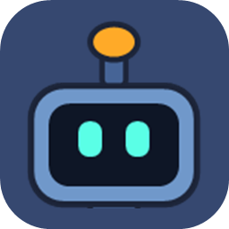
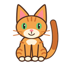
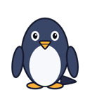
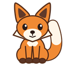
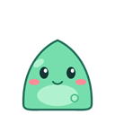
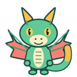

<div align="center">



# DeskBuddy

[](https://github.com/coldhighsun/DeskBuddy/actions/workflows/ci.yml)
[](tests)
[](https://github.com/coldhighsun/DeskBuddy/releases/latest)
[](https://github.com/coldhighsun/DeskBuddy/releases)
[](https://github.com/coldhighsun/DeskBuddy/releases)
[](https://dotnet.microsoft.com/)
[](https://github.com/coldhighsun/DeskBuddy)
[](LICENSE)
[](https://github.com/coldhighsun/DeskBuddy/stargazers)
[](https://github.com/coldhighsun/DeskBuddy/issues)
[](https://github.com/coldhighsun/DeskBuddy/pulls)
[](https://github.com/coldhighsun/DeskBuddy/commits/main)

**English** | [简体中文](README.zh-CN.md) | [繁體中文](README.zh-TW.md)

</div>

---

A desktop pet for work computers. It lives on your desktop, reacts to what you are doing, and stays out of the way.

## Features

**The pet**

- A small animated pet that walks along the taskbar, sleeps, gets tired and reacts when you drag it. Its eyes follow the
  mouse while it stands around.
- Fling it with the mouse and it flies off, bouncing off the screen ends. Drop it from high above the taskbar and it floats down under
  an umbrella or a parachute. It also climbs the sides of the
  screen and crawls along the top edge now and then (for pets that have the pictures for it).
- Right-click the pet to open the panel. Click it and it reacts with a remark (clicking again and again makes it cross; turn it off under "Behavior").
- While it is held in a long-running state (coding, a meeting...) it still takes a short stroll every few seconds
  instead of standing frozen for hours; switch this off with "stroll while busy" under Behavior.
- Pets that have the pictures for it hop now and then while they walk. With "say something unprompted" switched on (off
  by default) the pet makes a casual remark from time to time.

**It notices what you are doing**

Only the foreground process name is read, never window titles, command lines or keystrokes. Every reaction can be
switched off in the settings, and the process lists are editable. A pet only acts out the situations it has pictures
for; anything missing falls back to a similar state.

- Developing: sits down and codes when an IDE, editor or terminal is in front; shows a loading ring while a build runs
  and cheers when it ends (it cannot tell whether the build succeeded); sends a parcel when git talks to a remote;
  drinks coffee after hours of coding late at night; puts on glasses when you look something up right after coding.
- Meetings and chat: wears a headset and stays quiet while a meeting application is in front (Zoom and Tencent Meeting
  by default), and chats along while a chat application is.
- Away and power: waves when you come back after half an hour away; shows an empty battery below 20% on battery power
  and charges up when you plug in.
- The clock: a bowl of rice at lunch and dinner time, a glance at the watch when the working day ends (18:00 by default),
  a party hat on New Year's Day, Chinese New Year, Programmers' Day and Christmas, and, if you switch it on, a bell on
  the hour.
- Resting the mouse on the pet explains in words what it is doing.

**Pets**

- Twelve pets come with the app: robot (the default), cat, dog, rabbit, penguin, ghost, fox, panda, slime, dragon, cactus and sheep, all drawn as smooth vector art at 4x resolution.

| **robot** | **cat** | **dog** | **rabbit** | **penguin** | **ghost** |
| :---: | :---: | :---: | :---: | :---: | :---: |
|  |  |  |  |  |  |

| **fox** | **panda** | **slime** | **dragon** | **cactus** | **sheep** |
| :---: | :---: | :---: | :---: | :---: | :---: |
|  |  |  |  |  |  |

- The first tab of the panel lists every installed pet with a live preview, its picture size and what it can do (follows
  the mouse, climbs screen edges, keeps you company while developing, acts out situations), so you can compare and pick
  one. The tray menu switches the pet and its size as well.
- Switching pets plays a short animation: a UFO, a claw, a puff of smoke or a beam of light takes the old pet away and
  brings the new one in (pick one, or leave it on random, under Appearance; skipped when Windows animations are off).
- Automatic pet change (off by default): the pet swaps itself for another installed pet every 30 minutes, 1, 2 or 3
  hours, but only while it is idle or walking.

**The app**

- English, Simplified Chinese and Traditional Chinese: the interface follows the system language, or choose one in the
  settings (a change takes effect immediately, no restart). Translations live in `src/DeskBuddy.App/Resources`
  (`Strings.resx` is Simplified Chinese, `Strings.zh-Hant.resx` is Traditional Chinese, `Strings.en.resx` is English).
- Light and dark themes: the panel, tray menu and speech bubble follow the Windows app theme and switch as it changes, or
  choose light or dark under Appearance in the settings (takes effect at once). A Windows high-contrast theme is respected.
- The settings are a draft: changes take effect when you click Save, and Revert discards them.
- Tray icon, an About tab in the settings panel and single-instance protection.

## Add your own pet

A pet is a folder with a sprite sheet `atlas.png` (all frames in equal cells) and a `manifest.json` that
lists the states, their frame numbers and speeds. Drop the folder in and it shows up in the panel; no code changes are
needed. Put it in `%LOCALAPPDATA%\DeskBuddy\pets` (the "Open pet folder" button on the Pets tab opens it; upgrades never touch it) or in `pets/` next to the program. An optional `icon.png` (just the head) is used as the tray icon. See [pets/robot](pets/robot) for an example.
The bundled pets are drawn by the scripts in [tools](tools) (for example `tools/GenerateRobotPet.ps1`).

## Install

Download `DeskBuddy-Setup-x.y.z.exe` from the [Releases](https://github.com/coldhighsun/DeskBuddy/releases) page and run it. It installs per user and needs no administrator rights or .NET runtime. Installing a newer version over an old one upgrades it, and the uninstaller asks whether to keep your settings and logs.

Each release also offers two portable zips (no installation: unzip and run `DeskBuddy.exe`), told apart by the file name:

| File | .NET runtime | Contents |
| --- | --- | --- |
| `DeskBuddy-Portable-x.y.z-win-x64-with-runtime.zip` | Included, nothing to install | `DeskBuddy.exe` plus its dll files and `pets/` (larger download) |
| `DeskBuddy-Portable-x.y.z-win-x64-no-runtime.zip` | Not included, needs the [.NET 11 Desktop Runtime](https://dotnet.microsoft.com/download/dotnet/11.0) (x64) | A single `DeskBuddy.exe` plus `pets/` (much smaller download) |

Pick the `with-runtime` zip if you are unsure; pick `no-runtime` if the .NET 11 Desktop Runtime is already installed.

To verify a download, compare its SHA-256 with the matching line of `SHA256SUMS.txt` on the same release page:

```powershell
Get-FileHash .\DeskBuddy-Portable-x.y.z-win-x64-no-runtime.zip -Algorithm SHA256
```

## Build

Requires Windows and the [.NET 11 SDK](https://dotnet.microsoft.com/download).

```bash
dotnet build DeskBuddy.slnx
dotnet test DeskBuddy.slnx
dotnet run --project src/DeskBuddy.App
```

To build the installer, install [Inno Setup 7](https://jrsoftware.org/isinfo.php) and run:

```bash
powershell -NoProfile -File tools/Build-Installer.ps1
```

The two portable zips (`with-runtime`: exe plus dll files and `pets/`; `no-runtime`: a single exe plus `pets/`) are built with the script below into `artifacts/portable`; pass `-Variant WithRuntime` or `-Variant NoRuntime` to build only one:

```bash
powershell -NoProfile -File tools/Build-Portable.ps1
```

Versions are derived from git tags (`v1.2.3`) by [MinVer](https://github.com/adamralph/minver). Pushing a `v*` tag makes
the CI workflow build and test, build the installer and the two portable zips and publish them as a GitHub release (a tag with a hyphen, such as
`v1.2.0-rc.1`, is marked as a pre-release).

## License

[MIT](LICENSE)
