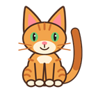
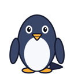
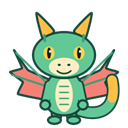

<div align="center">


# DeskBuddy

[](https://github.com/coldhighsun/DeskBuddy/actions/workflows/ci.yml)
[](tests)
[](https://github.com/coldhighsun/DeskBuddy/releases/latest)
[](https://github.com/coldhighsun/DeskBuddy/releases)
[](https://github.com/coldhighsun/DeskBuddy/releases)
[](https://dotnet.microsoft.com/)
[](https://github.com/coldhighsun/DeskBuddy)
[](LICENSE)
[](https://github.com/coldhighsun/DeskBuddy/stargazers)
[](https://github.com/coldhighsun/DeskBuddy/issues)
[](https://github.com/coldhighsun/DeskBuddy/pulls)
[](https://github.com/coldhighsun/DeskBuddy/commits/main)

[English](README.md) | **简体中文** | [繁體中文](README.zh-TW.md)

</div>

---

一只住在办公电脑桌面上的桌面宠物。它会根据你的操作做出反应，同时尽量不打扰你。

## 功能

**宠物本身**

- 小巧的动画宠物：沿任务栏行走、睡觉、疲倦，被拖动时也有反应。站着不动时眼睛会跟着鼠标转。
- 用鼠标甩一下，它会飞出去并在屏幕两端弹回。从任务栏上方高处松手，它会撑着雨伞或降落伞飘落。它还会
  随机沿屏幕两侧攀爬、挂在顶部横向移动（宠物需要有对应的画面）。
- 右键点击宠物打开面板；左键点击它会有所反应并说句话（连续猛点会把它惹毛；可在“行为”里关闭）。
- 处于长驻状态（写代码、开会等）时，它不会几个小时一动不动，而是每隔几秒短暂溜达一小段；可在“行为”里关闭“忙碌时溜达”。
- 带有对应图片的宠物走路时偶尔会跳一下。打开“主动说话”（默认关闭）后，宠物会时不时随口说一句。

**它会注意你在做什么**

只读取前台进程名，不读取窗口标题、命令行和按键内容。每一项反应都可以在设置里单独关闭，进程列表也可以修改。
宠物只会表演自己有图片的情境，缺少的状态会回退到相近状态。

- 开发：IDE、编辑器或终端在前台时坐到桌前敲代码；构建时显示加载转圈、结束时欢呼（无法判断构建成败）；
  git 与远程同步时寄快递；深夜连续开发数小时后喝咖啡；刚写完代码就去查资料时戴上眼镜。
- 会议与聊天：会议软件（默认 Zoom、腾讯会议）在前台时戴上耳机安静陪着；聊天软件在前台时会陪着聊天。
- 离开与电量：离开超过半小时再回来会挥手欢迎；用电池且电量低于 20% 时举着空电池，插上电源后开心充电。
- 时间：饭点端起碗筷、到下班时间看表（默认 18:00，可改）、元旦／春节／程序员节／圣诞节戴派对帽，整点敲钟报时需要在设置里手动开启。
- 鼠标停在宠物上会用文字说明它在做什么。

**宠物**

- 自带十二只宠物：robot（默认）、cat、dog、rabbit、penguin、ghost、fox、panda、slime、dragon、cactus、sheep，全部为平滑矢量风格（4 倍分辨率）。

| **robot** | **cat** | **dog** | **rabbit** | **penguin** | **ghost** |
| :---: | :---: | :---: | :---: | :---: | :---: |
|  |  |  |  |  |  |

| **fox** | **panda** | **slime** | **dragon** | **cactus** | **sheep** |
| :---: | :---: | :---: | :---: | :---: | :---: |
|  |  |  |  |  |  |

- 面板的第一个标签列出所有已安装的宠物，带动画预览、画面尺寸和能力标签（跟随鼠标、攀爬屏幕边缘、开发陪伴、情境动作），
  方便对比后选择；托盘菜单也可以切换宠物和尺寸。
- 切换宠物时会播放一段短动画：飞碟、机械爪、烟雾或光束把旧宠物带走、再把新宠物送来（可在“外观”里指定一种，或保持随机；系统关闭动画效果时不播放）。
- 自动换宠物（默认关闭）：每隔 30 分钟、1、2 或 3 小时，宠物会自己换成另一只已安装的宠物，且只在它空闲或行走时才换。

**应用**

- 支持简体中文、繁体中文和英文：界面默认跟随系统语言，也可以在设置里手动选择（立即生效，无需重启）。翻译文件在
  `src/DeskBuddy.App/Resources`（`Strings.resx` 为简体中文，`Strings.zh-Hant.resx` 为繁体中文，`Strings.en.resx` 为英文）。
- 支持深色和浅色主题：面板、托盘菜单和对话气泡默认跟随 Windows 的应用主题并随之实时切换，也可以在设置的“外观”里手动选择浅色或深色（立即生效）。
  Windows 高对比度主题优先。
- 设置页是“草稿 + 保存”：改动点“保存”后才生效，“还原”会丢弃改动。
- 托盘图标、关于窗口与单实例保护。

## 添加你自己的宠物

宠物是一个文件夹：一张精灵图集 `atlas.png`（所有帧按相同大小的格子排列）加一个 `manifest.json`
（列出各状态的帧编号和速度）。把文件夹放进 `%LOCALAPPDATA%\DeskBuddy\pets`（宠物页的“打开宠物文件夹”按钮会打开它，升级不会动它）或程序旁的 `pets/`，宠物就会出现在面板里，不需要改任何代码。可选的 `icon.png`（只画头部）
会用作托盘图标。示例见 [pets/robot](pets/robot)。自带宠物由 [tools](tools) 里的脚本绘制（例如 `tools/GenerateRobotPet.ps1`）。

## 安装

从 [Releases](https://github.com/coldhighsun/DeskBuddy/releases) 页面下载 `DeskBuddy-Setup-x.y.z.exe` 并运行。按当前用户安装，无需管理员权限，也无需另装 .NET 运行时。覆盖安装新版本即可升级，卸载时会询问是否保留设置和日志。

每个 Release 还提供两个便携 zip（无需安装，解压后运行 `DeskBuddy.exe`），通过文件名区分：

| 文件 | .NET 运行时 | 内容 |
| --- | --- | --- |
| `DeskBuddy-Portable-x.y.z-win-x64-with-runtime.zip` | 已包含，无需另装 | `DeskBuddy.exe` 及其 dll 文件 + `pets/`（体积较大） |
| `DeskBuddy-Portable-x.y.z-win-x64-no-runtime.zip` | 不包含，需先安装 [.NET 11 桌面运行时](https://dotnet.microsoft.com/download/dotnet/11.0)（x64） | 单个 `DeskBuddy.exe` + `pets/`（体积小得多） |

不确定时选 `with-runtime`；已安装 .NET 11 桌面运行时的可以选 `no-runtime`。

如需校验下载的文件，请将其 SHA-256 与同一 Release 页面上 `SHA256SUMS.txt` 中对应的一行比对：

```powershell
Get-FileHash .\DeskBuddy-Portable-x.y.z-win-x64-no-runtime.zip -Algorithm SHA256
```

## 构建

需要 Windows 和 [.NET 11 SDK](https://dotnet.microsoft.com/download)。

```bash
dotnet build DeskBuddy.slnx
dotnet test DeskBuddy.slnx
dotnet run --project src/DeskBuddy.App
```

打包安装程序需要先安装 [Inno Setup 7](https://jrsoftware.org/isinfo.php)，然后运行：

```bash
powershell -NoProfile -File tools/Build-Installer.ps1
```

两个便携 zip 包（`with-runtime`：exe + dll 文件 + `pets/`；`no-runtime`：单个 exe + `pets/`）用下面的脚本生成，输出在 `artifacts/portable`；加 `-Variant WithRuntime` 或 `-Variant NoRuntime` 可只生成其中一个：

```bash
powershell -NoProfile -File tools/Build-Portable.ps1
```

版本号由 [MinVer](https://github.com/adamralph/minver) 根据 git tag（`v1.2.3`）自动生成。推送 `v*` tag 后，CI 会构建、测试、
打包安装程序和两个便携 zip 并发布为 GitHub Release（带连字符的 tag，如 `v1.2.0-rc.1`，会标记为预发布）。

## 许可证

[MIT](LICENSE)
