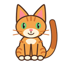

<div align="center">


# DeskBuddy

[](https://github.com/coldhighsun/DeskBuddy/actions/workflows/ci.yml)
[](tests)
[](https://github.com/coldhighsun/DeskBuddy/releases/latest)
[](https://github.com/coldhighsun/DeskBuddy/releases)
[](https://github.com/coldhighsun/DeskBuddy/releases)
[](https://dotnet.microsoft.com/)
[](https://github.com/coldhighsun/DeskBuddy)
[](LICENSE)
[](https://github.com/coldhighsun/DeskBuddy/stargazers)
[](https://github.com/coldhighsun/DeskBuddy/issues)
[](https://github.com/coldhighsun/DeskBuddy/pulls)
[](https://github.com/coldhighsun/DeskBuddy/commits/main)

[English](README.md) | [简体中文](README.zh-CN.md) | **繁體中文**

</div>

---

一隻住在辦公電腦桌面上的桌面寵物。它會根據你的操作做出反應，同時盡量不打擾你。

## 功能

**寵物本身**

- 小巧的動畫寵物：沿工作列行走、睡覺、疲倦，被拖曳時也有反應。站著不動時眼睛會跟著滑鼠轉，用力晃動滑鼠它會頭暈。
- 從工作列上方高處放手，它會撐著雨傘或降落傘飄落。它還會
  隨機沿螢幕兩側攀爬、掛在頂部橫向移動（寵物需要有對應的畫面）。
- 處於長駐狀態（寫程式、開會等）時，它不會好幾個小時一動也不動，而是每隔幾秒短暫散步一小段；可在「行為」裡關閉「忙碌時散步」。
- 帶有對應圖片的寵物走路時偶爾會跳一下。開啟「主動說話」（預設關閉）後，寵物會時不時隨口說一句。

**它會留意你在做什麼**

只讀取前景處理程序名稱，不讀取視窗標題、命令列和按鍵內容。每一項反應都可以在設定裡單獨關閉，處理程序清單也可以修改。
寵物只會表演自己有圖片的情境，缺少的狀態會退回到相近的狀態。

- 開發：IDE、編輯器或終端機在前景時坐到桌前敲程式；建置時顯示載入轉圈、結束時歡呼（無法判斷建置成敗）；
  git 與遠端同步時寄快遞；深夜連續開發數小時後喝咖啡；剛寫完程式就去查資料時戴上眼鏡。
- 會議與聊天：會議軟體（預設 Zoom、騰訊會議）在前景時戴上耳機安靜陪著；聊天軟體在前景時會陪著聊天。
- 離開與電量：離開超過半小時再回來會揮手歡迎；使用電池且電量低於 20% 時舉著空電池，插上電源後開心充電。
- 時間：用餐時間端起碗筷、到下班時間看錶（預設 18:00，可修改）、元旦／春節／程式設計師節／聖誕節戴派對帽，整點敲鐘報時需要在設定裡手動開啟。
- 這些圖案都帶小字標籤（BLD、GIT、MTG、LOW 等），滑鼠停在寵物上還會用文字說明它在做什麼。

**寵物**

- 內建七隻寵物：robot（預設）、cat、dog、rabbit、penguin、ghost、fox，全部為平滑向量風格（4 倍解析度）。

| **robot** | **cat** | **dog** | **rabbit** | **penguin** | **ghost** | **fox** |
| :---: | :---: | :---: | :---: | :---: | :---: | :---: |
|  |  |  |  |  |  |  |

- 面板的第一個分頁列出所有已安裝的寵物，附有動畫預覽、畫面尺寸和能力標籤（跟隨滑鼠、攀爬螢幕邊緣、開發陪伴、情境動作），
  方便比較後選擇；系統匣選單也可以切換寵物和尺寸。

**應用程式**

- 支援繁體中文、簡體中文和英文：介面預設跟隨系統語言，也可以在設定裡手動選擇（立即生效，無需重新啟動）。翻譯檔在
  `src/DeskBuddy.App/Resources`（`Strings.resx` 為簡體中文，`Strings.zh-Hant.resx` 為繁體中文，`Strings.en.resx` 為英文）。
- 支援深色和淺色主題：面板、系統匣選單和對話氣泡預設跟隨 Windows 的應用程式主題並即時切換，也可以在設定的「外觀」裡手動選擇淺色或深色（立即生效）。
  Windows 高對比主題優先。
- 設定頁是「草稿 + 儲存」：變更按「儲存」後才生效，「還原」會捨棄變更。
- 系統匣圖示、關於視窗與單一執行個體保護。

## 加入你自己的寵物

寵物是一個資料夾：一張精靈圖集 `atlas.png`（所有影格按相同大小的格子排列）加一個 `manifest.json`
（列出各狀態的影格編號和速度）。把資料夾放進 `%LOCALAPPDATA%\DeskBuddy\pets`（寵物頁的「開啟寵物資料夾」按鈕會開啟它，升級不會動它）或程式旁的 `pets/`，寵物就會出現在面板裡，不需要修改任何程式碼。可選的 `icon.png`（只畫頭部）
會用作系統匣圖示。範例見 [pets/robot](pets/robot)。內建寵物由 [tools](tools) 裡的指令碼繪製（例如 `tools/GenerateRobotPet.ps1`）。

## 安裝

從 [Releases](https://github.com/coldhighsun/DeskBuddy/releases) 頁面下載 `DeskBuddy-Setup-x.y.z.exe` 並執行。依目前使用者安裝，無需系統管理員權限，也無需另外安裝 .NET 執行階段。直接覆蓋安裝新版本即可升級，解除安裝時會詢問是否保留設定和記錄檔。

## 建置

需要 Windows 和 [.NET 11 SDK](https://dotnet.microsoft.com/download)。

```bash
dotnet build DeskBuddy.slnx
dotnet test DeskBuddy.slnx
dotnet run --project src/DeskBuddy.App
```

封裝安裝程式需要先安裝 [Inno Setup 7](https://jrsoftware.org/isinfo.php)，然後執行：

```bash
powershell -NoProfile -File tools/Build-Installer.ps1
```

可攜式 zip 套件（單一 exe + `pets/`，免安裝）用下面的指令碼產生，輸出在 `artifacts/portable`：

```bash
powershell -NoProfile -File tools/Build-Portable.ps1
```

版本號由 [MinVer](https://github.com/adamralph/minver) 根據 git tag（`v1.2.3`）自動產生。推送 `v*` tag 後，CI 會建置、測試、
封裝安裝程式和可攜式 zip，並發佈為 GitHub Release（帶連字號的 tag，如 `v1.2.0-rc.1`，會標記為預先發行）。

## 授權

[MIT](LICENSE)
